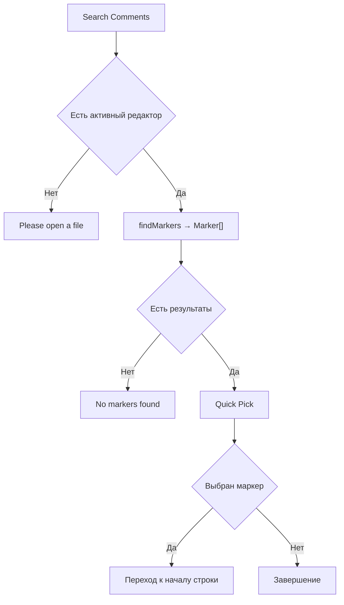

# Документация CommentSearch

## Краткое техническое задание

Разработать плагин для Visual Studio Code, который по команде `Search Comments` находит первый TODO или BUG в каждой строке активного документа, показывает результаты в Quick Pick и переводит курсор к выбранной строке. Поиск не учитывает регистр. При отсутствии редактора или маркеров необходимо показывать уведомление; отмена выбора не должна менять позицию курсора.

## Архитектура

В `package.json` объявлены команда `commentsearch.Search` и точка входа `out/extension.js`. При вызове команды VS Code активирует расширение, а `activate` регистрирует её обработчик через Extension API. Регистрация хранится в `context.subscriptions` и освобождается средой при завершении работы.

## Данные и функции

Вся логика находится в `src/extension.ts`. Тип `MarkerType` допускает TODO и BUG. Объект `Marker` содержит `type` — тип маркера, `line` — индекс строки с нуля, `description` — текст после маркера.

| Функция | Параметры | Назначение и результат |
| --- | --- | --- |
| `findMarkers` | `document: vscode.TextDocument` | Построчно ищет маркеры и возвращает `Marker[]`; при отсутствии совпадений — пустой массив |
| `activate` | `context: vscode.ExtensionContext` | Регистрирует команду поиска; возвращаемого значения нет |
| `deactivate` | Нет | Вызывается при деактивации; дополнительных действий не выполняет |

Поиск использует выражение `/\b(TODO|BUG)\b\s*:?\s*(.*)/i`. Найденный тип приводится к верхнему регистру, крайние пробелы описания удаляются. Массив результатов преобразуется методом `map` в элементы Quick Pick. После выбора `Selection` устанавливает курсор в колонку 0, а `revealRange` прокручивает редактор к строке.

## Особенности

Поиск охватывает только активный документ и не различает комментарии, строки и код. В строке с несколькими маркерами находится только первый. Для показа номера строки к индексу добавляется единица. Вызов `markers.sort()` без компаратора не сортирует объекты по их полям; в текущей реализации сохраняется порядок строк.

Исходный код: https://github.com/Weebuss/CommentSearch  
Справочник VS Code: https://code.visualstudio.com/api/get-started/extension-anatomy
